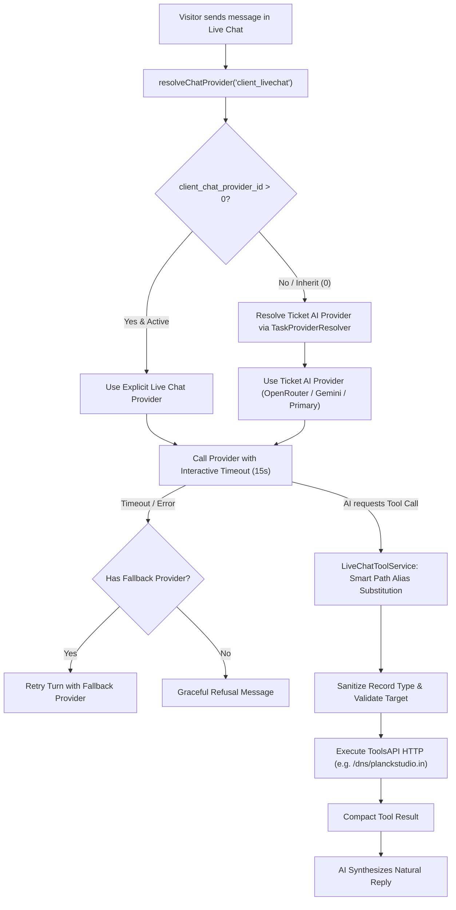

# Implementation Plan: Live Chat AI Provider Resolution & ToolsAPI Fix

## Goal Description
Resolve two operational issues identified in the live environment:
1. **AI Provider Resolution & LM Studio Timeout**:
   - In **AI Providers Manager** (`Active AI Provider Roles & Assignments`), Client Live Chat is configured to `-- Same as Ticket AI (Inherit) --` (`client_chat_provider_id = 0`).
   - However, `ChatService::resolveChatProvider('client_livechat')` incorrectly fell back to `copilot_primary_provider_id`, which was assigned to a local LM Studio instance ("Cheaper Inference", model `gpt-5.6-luna`). Because local LM Studio was not running, the request hung for **120 seconds** before timing out and crashing the live chat turn.
   - **Fix**: Align Client Live Chat to strictly inherit the active **Support Ticket AI Provider** (`task_provider_map['ticket_reply']` / `primary_provider_id` via `TaskProviderResolver`), enforce a fast interactive SLA timeout for live chat (15s max), and add seamless automatic fallback to the secondary provider if the primary provider is unreachable.
2. **ToolsAPI Execution HTTP 500 on `toolsapi_dns_lookup`**:
   - When the AI called `toolsapi_dns_lookup` for `planckstudio.in`, ToolsAPI returned `HTTP 500`.
   - **Root Cause**: `LiveChatToolService::executeUpstreamHttp` was performing naive string replacement (`strpos($finalPath, '{' . $key . '}')`). When the AI passed `{"target": "planckstudio.in"}` (or `{"host": "..."}`), `{domain}` in `/dns/{domain}` remained unreplaced, causing cURL to request `https://toolsapi.2hs.in/dns/%7Bdomain%7D?target=planckstudio.in`, which failed on the ToolsAPI server with HTTP 500.
   - **Fix**: Adopt the robust path parameter alias mapping from `ToolsExecutionService::applyPathParams` (mapping `{domain}`, `{target}`, `{host}`, `{url}`, `{ip}` interchangeably), remove path parameters from query strings, sanitize DNS query `type` to valid record types (`A`, `AAAA`, `MX`, etc.), and log the complete URL and response excerpt on failures.

---



---

## User Review Required

> [!IMPORTANT]
> **Active Provider Assignment**: When Client Live Chat is set to `0` in Admin settings, it will now strictly inherit the provider assigned to **Support Ticket AI** (`primary_provider_id` or `task_provider_map['ticket_reply']`). It will **never** use Admin Copilot's provider or local LM Studio unless explicitly selected.
> 
> **Interactive Timeout**: Any provider called by Live Chat will have a strict **15-second timeout** instead of the 120-second default of local offline models. If a provider fails to respond in 15 seconds, it will fail over to the fallback provider or return a helpful response immediately without freezing the user's browser.

---

## Open Questions

> [!NOTE]
> 1. Should we add an automatic failover to the global fallback provider (`fallback_provider_id`) if the primary chat provider times out or returns a connection error?
>    *(Recommended: Yes, this ensures zero downtime if a local model or primary endpoint is temporarily offline)*

---

## Proposed Changes

### Component 1: Provider Resolution & Failover in `lib/ChatService.php`
#### [MODIFY] [`lib/ChatService.php`](file:///d:/Code/thekugelblitz/sahdev/lib/ChatService.php)
1. **Fix `resolveChatProvider` channel inheritance logic**:
   - For `client_livechat`:
     - Check `$settings->client_chat_provider_id`. If `> 0` and active, use it.
     - If `<= 0` (Inherit), resolve Support Ticket AI provider using:
       `TaskProviderResolver::resolveProviderId(TaskProviderResolver::TASK_TICKET_REPLY, null, (array) $settings)`.
     - Fall back to `$settings->primary_provider_id`.
     - **Remove** fallback to `copilot_primary_provider_id` for client live chat.
2. **Interactive Live Chat Timeout & Failover**:
   - When invoking `$provider->generateChat(...)` in `handleClientMessage`:
     - Pass `'timeout' => 15` in `$settings`.
     - Wrap provider invocation with automatic retry using `$settings->fallback_provider_id` if the primary provider times out or throws a connection error.

---

### Component 2: Smart Path Binding & DNS Sanitization in `lib/LiveChatToolService.php`
#### [MODIFY] [`lib/LiveChatToolService.php`](file:///d:/Code/thekugelblitz/sahdev/lib/LiveChatToolService.php)
1. **Replace naive path substitution in `executeUpstreamHttp` with regex alias binding**:
   - Replace placeholders `{domain}`, `{target}`, `{host}`, `{url}`, `{ip}`, `{cidr}` by matching against exact parameter names and common aliases (`domain`, `target`, `host`, `hostname`, `url`, `ip`).
   - Track consumed path parameters so they are **not** appended to `$queryParams`.
2. **Force IPv4 DNS queries**:
   - For `toolsapi_dns_lookup`, always send `$queryParams['type'] = 'A'`, regardless of the type requested by the model. Expose only `A` in the tool schema.
3. **Enhanced diagnostic logging**:
   - On upstream HTTP failures (4xx or 5xx), log the full URL, status code, and first 300 characters of the response body into `tblsahdev_module_logs`.

---

## Verification Plan

### Automated Tests
Run the expanded test suite:
```powershell
php scratch/test_livechat_tools.php
```
Verify provider resolution logic:
- `ChatService::resolveChatProvider('client_livechat')` with `client_chat_provider_id = 0` resolves Ticket AI provider, not Copilot or LM Studio.
- Verify path parameter alias binding:
  - Tool `/dns/{domain}` with arguments `['target' => 'planckstudio.in']` produces URL `/dns/planckstudio.in` (NOT `/dns/{domain}?target=planckstudio.in`).
  - Tool `/ping/{host}` with arguments `['target' => '8.8.8.8']` produces URL `/ping/8.8.8.8`.
  - Tool `/ssl/{target}` with arguments `['domain' => 'google.com']` produces URL `/ssl/google.com`.
  - Any requested query type, including `AAAA`, is forced to `'A'`.

### Manual Verification
1. Open WHMCS Client Live Chat widget.
2. Send: "Can you check the DNS records for planckstudio.in?"
3. Verify:
   - Request is handled by Ticket AI provider (not LM Studio timeout).
   - `toolsapi_dns_lookup` executes with URL `/dns/planckstudio.in` without HTTP 500 error.
   - Reply is returned swiftly with verified DNS records.
