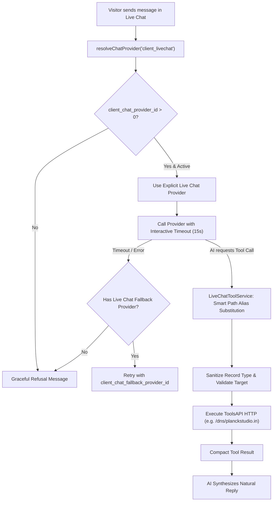

# Implementation Plan: Live Chat AI Provider Resolution & ToolsAPI Fix

## Goal Description
Resolve two operational issues identified in the live environment:
1. **AI Provider Resolution & LM Studio Timeout**:
   - Client Live Chat must use its own provider selection in **Client Live Chat > Customizer**, independent of Support Ticket AI.
   - The old resolver inherited Ticket AI when `client_chat_provider_id` was `0`, and the error path used the shared ticket `fallback_provider_id`. This could route live chat to a local LM Studio provider ("Cheaper Inference", model `gpt-5.6-luna`).
   - **Fix**: Require a dedicated active live-chat provider, add a separate optional `client_chat_fallback_provider_id`, and never inherit ticket or Copilot assignments.
2. **ToolsAPI Execution HTTP 500 on `toolsapi_dns_lookup`**:
   - When the AI called `toolsapi_dns_lookup` for `planckstudio.in`, ToolsAPI returned `HTTP 500`.
   - **Root Cause**: `LiveChatToolService::executeUpstreamHttp` was performing naive string replacement (`strpos($finalPath, '{' . $key . '}')`). When the AI passed `{"target": "planckstudio.in"}` (or `{"host": "..."}`), `{domain}` in `/dns/{domain}` remained unreplaced, causing cURL to request `https://toolsapi.2hs.in/dns/%7Bdomain%7D?target=planckstudio.in`, which failed on the ToolsAPI server with HTTP 500.
   - **Fix**: Adopt the robust path parameter alias mapping from `ToolsExecutionService::applyPathParams` (mapping `{domain}`, `{target}`, `{host}`, `{url}`, `{ip}` interchangeably), remove path parameters from query strings, force IPv4 `A` records, and log the complete URL and response excerpt on failures.

---



---

## User Review Required

> [!IMPORTANT]
> **Independent Provider Assignment**: Select Client Live Chat's primary and optional failover in **Client Live Chat > Customizer**. An empty selection does not inherit Ticket AI, Copilot, or a generic active provider.
> 
> **Interactive Timeout**: Any provider called by Live Chat has a strict **15-second timeout**. If the primary fails, only the separately selected Live Chat failover can be used.

---

## Provider Isolation

> [!NOTE]
> Failover is isolated: `client_chat_fallback_provider_id` is used only for Client Live Chat.

---

## Proposed Changes

### Component 1: Provider Resolution & Failover in `lib/ChatService.php`
#### [MODIFY] [`lib/ChatService.php`](file:///d:/Code/thekugelblitz/sahdev/lib/ChatService.php)
1. **Isolate `client_livechat` provider resolution**:
   - Resolve only the active provider selected by `$settings->client_chat_provider_id`.
   - If unset or inactive, do not use Ticket AI, Copilot, ticket fallback, or generic provider search.
2. **Interactive Live Chat Timeout & Failover**:
   - When invoking `$provider->generateChat(...)` in `handleClientMessage`:
     - Pass `'timeout' => 15` in `$settings`.
     - Wrap provider invocation with failover using only `$settings->client_chat_fallback_provider_id`.

---

### Component 2: Smart Path Binding & DNS Sanitization in `lib/LiveChatToolService.php`
#### [MODIFY] [`lib/LiveChatToolService.php`](file:///d:/Code/thekugelblitz/sahdev/lib/LiveChatToolService.php)
1. **Replace naive path substitution in `executeUpstreamHttp` with regex alias binding**:
   - Replace placeholders `{domain}`, `{target}`, `{host}`, `{url}`, `{ip}`, `{cidr}` by matching against exact parameter names and common aliases (`domain`, `target`, `host`, `hostname`, `url`, `ip`).
   - Track consumed path parameters so they are **not** appended to `$queryParams`.
2. **Force IPv4 DNS queries**:
   - For `toolsapi_dns_lookup`, always send `$queryParams['type'] = 'A'`, regardless of the type requested by the model. Expose only `A` in the tool schema.
3. **Enhanced diagnostic logging**:
   - On upstream HTTP failures (4xx or 5xx), log the full URL, status code, and first 300 characters of the response body into `tblsahdev_module_logs`.

---

## Verification Plan

### Automated Tests
Run the expanded test suite:
```powershell
php scratch/test_livechat_tools.php
```
Verify provider resolution logic:
- `ChatService::resolveChatProvider('client_livechat')` with `client_chat_provider_id = 0` returns no provider and does not resolve Ticket AI, Copilot, or a generic provider.
- Verify path parameter alias binding:
  - Tool `/dns/{domain}` with arguments `['target' => 'planckstudio.in']` produces URL `/dns/planckstudio.in` (NOT `/dns/{domain}?target=planckstudio.in`).
  - Tool `/ping/{host}` with arguments `['target' => '8.8.8.8']` produces URL `/ping/8.8.8.8`.
  - Tool `/ssl/{target}` with arguments `['domain' => 'google.com']` produces URL `/ssl/google.com`.
  - Any requested query type, including `AAAA`, is forced to `'A'`.

### Manual Verification
1. Open WHMCS Client Live Chat widget.
2. Send: "Can you check the DNS records for planckstudio.in?"
3. Verify:
   - Request is handled only by the provider selected in Client Live Chat > Customizer.
   - `toolsapi_dns_lookup` executes with URL `/dns/planckstudio.in` without HTTP 500 error.
   - Reply is returned swiftly with verified DNS records.
