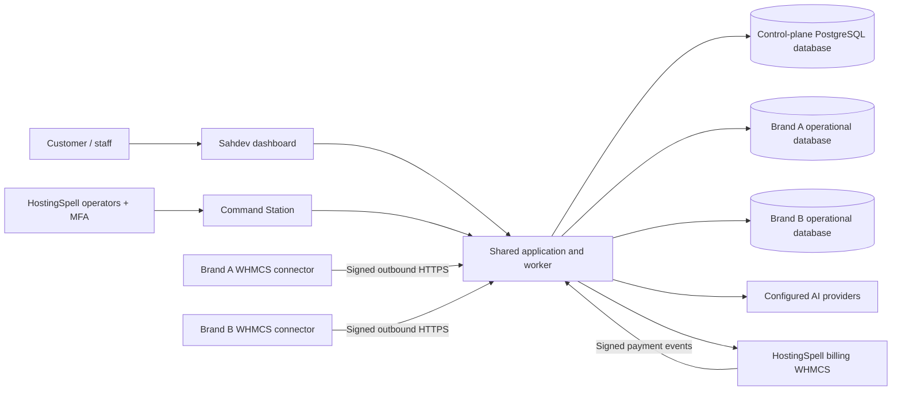

# Sahdev Cloud — pilot release

This directory contains the runnable SaaS platform. It is a Laravel 13 / PHP 8.4 modular monolith with a web process, database queue worker, scheduler, and PostgreSQL. The existing WHMCS module remains independently installable and compatible with PHP 7.4+.

The initial release implements the account → brand → funding → signed connector → metered AI journey. It is **not a claim that the full product migration or a live deployment is finished**. Provider credentials, SMTP, HostingSpell billing credentials, domains, release signing, backups, and installation-specific WHMCS validation must be supplied and exercised before paid onboarding. No real payment or AI call is made by the regression suite.

## What works

- Signup, email verification, password reset, organization membership, brand-specific viewer/operator access, and owner/admin/billing roles.
- Multiple brands per organization, pooled credits or explicit allocations, monthly brand budgets, organization/brand suspensions, seat/brand/model/concurrency limits.
- Integer microcredit accounting: grants, transfers, reservations, settlements, releases, reversals, immutable ledger entries and reconciliation commands. Budget checks and wallet holds commit in one control-plane transaction.
- Customer dashboard, billing/usage views, staff management, domain verification, enrollment, and signed downloads.
- Operator Command Station behind password + TOTP verification. CRUD for providers, models, plans, credit packs and promotions; encrypted provider keys; immutable model price versions; operator credit grants and exception reconciliation with evidence.
- OpenAI-compatible Chat Completions providers (including OpenRouter and Gemini's compatible endpoint) and Anthropic Messages. Text and locally executed function tools only. No arbitrary endpoints, redirects, automatic paid retries, cloud SQL execution, or silent model fallback.
- HostingSpell WHMCS invoice creation and verified payment delivery. Its configured Razorpay, PayPal and Stripe gateways remain the payment processors. An outbox hook retries payment notifications; the cloud reconciles missed paid invoices.
- Separate PostgreSQL database/login for each brand, with per-brand content retention. Provisioning credentials are used only by an operator command and are excluded from web/worker container environments.
- An opt-in **Sahdev Cloud** provider in the existing WHMCS module. Ticket AI, chat/Copilot and cron provider selection can use it while retaining the module's native rendering, record links, ACL, action previews, transactional changes, journals and rollback.

## Data and transaction boundaries



The control-plane database owns organizations, identities, brands, installation credentials, plans, price versions, orders, invoices' references, budgets, holds, usage and audit events. A staff user does not get a database. A brand gets one operational database; it is not a replica of that customer's WHMCS database.

The control plane temporarily holds encrypted queued prompts and encrypted result-delivery caches. Terminal request payloads are cleared; result caches expire with the retention setting. Brand databases contain inference records, with encrypted content only when the owner enables retention. Financial and audit evidence is retained separately. This is logical/database isolation inside a shared service, not a dedicated machine or protection against compromise of the shared application's master encryption key.

All monetary arithmetic uses integers. One Sahdev credit has 1,000,000 microcredits. A pack's real-currency price is separate from the number of credits it grants. Prices are configured by HostingSpell, never inferred from model names. Customer rates are credits per million input/output tokens. Cached input uses the published input rate; provider costs shown internally are estimates in the configured provider currency, not a substitute for reconciling vendor invoices.

A pooled brand spends the organization's pool subject to its monthly cap. An allocated brand spends only its allocated wallet; allocating decreases the pool by the same amount. A monthly budget neither creates credits nor guarantees an allocation. Holds count against both the selected wallet and the UTC calendar month in which the request was accepted. Settlement can never charge more than its reservation; unexpected provider overages are recorded for review.

WHMCS mutations and rollback remain local transactions governed by `CopilotDatabasePolicy` and `CopilotOperationService`. The cloud model can propose tools but has no API that runs SQL or approves those proposals. A WHMCS rollback does not undo provider usage or a SaaS credit charge. An external payment, email or provisioning action cannot be promised an atomic database rollback. SaaS suspension does not suspend a customer's hosting services, and existing local rollback remains available independently of the cloud.

## Local development

Use PHP 8.4 with curl, mbstring, intl, PDO PostgreSQL/SQLite, sodium and zip, Composer, and PostgreSQL 15+ (deployment uses 18).

```sh
cd saas
composer install
php tools/setup-env.php
# Edit .env: APP_ENV=local, APP_URL=http://127.0.0.1:8000,
# SESSION_SECURE_COOKIE=false, DB_HOST/DB_DATABASE/DB_USERNAME/DB_PASSWORD,
# MAIL_MAILER=log for development only.
mkdir -p storage/framework/cache storage/framework/sessions storage/framework/views storage/logs storage/app/private
php artisan migrate
php artisan db:seed
php artisan platform:operator owner@example.com --create
php artisan serve --host=127.0.0.1 --port=8000
# In separate terminals:
php artisan queue:work --tries=1 --timeout=110
php artisan schedule:work
```

The seed adds only a Launch plan with five brands, ten seats and two concurrent requests. It creates no sample users, keys, model prices, credit packs or free funds. Add providers and models, then explicitly grant the models to a plan. The cloud worker needs outbound HTTPS to approved provider domains. Test fixtures are confined to disposable databases.

## Hetzner pilot deployment

Use a dedicated subdomain, for example `app.hostingspell.com`, whose DNS points to the server. The application expects installation at the domain root. Keep marketing at `hostingspell.com/sahdev` if desired. The Compose file exposes only HTTP/HTTPS; PostgreSQL is not published to the host or Internet. Customer WHMCS MySQL ports never need to be opened.

1. On a fresh Linux server, install Docker Engine + Compose, restrict SSH to your operators, and allow inbound TCP 80/443. Start with 2 vCPU / 4 GB only for a measured pilot. One worker is intentionally configured; increase worker count after observing queue latency and memory. This single-server topology is not highly available.
2. Clone the `saas` branch and change to `saas/`. Generate missing application secrets without printing them:

   ```sh
   docker run --rm -u "$(id -u):$(id -g)" -v "$PWD:/workspace" -w /workspace php:8.4-cli php tools/setup-env.php
   mkdir -p releases
   chmod 755 releases
   # Edit .env: APP_HOST, APP_URL, ACME_EMAIL, SMTP and billing configuration.
   # Keep REGISTRATION_ENABLED=false until onboarding checks pass.
   docker compose build
   docker compose up -d db
   docker compose run --rm app php artisan migrate --force
   docker compose run --rm app php artisan db:seed --force
   docker compose run --rm app php artisan platform:operator owner@example.com --create
   docker compose up -d
   ```

3. Sign in, enroll TOTP, configure provider credentials and model prices, grant models to the Launch plan, and create credit packs/promotions. Secrets are write-only in forms and encrypted using `APP_KEY`. Existing keys remain unchanged when the replacement field is empty. Keep `APP_KEY` and previous keys backed up separately; losing them loses access to encrypted provider/installation/tenant credentials and retained content.
4. After creating a brand, provision its database using a short-lived operator process. Do not place provisioning credentials in the application's `.env` or configuration cache:

   ```sh
   read -rsp 'PostgreSQL operator password: ' SAHDEV_PROVISION_PASSWORD; echo
   export SAHDEV_PROVISION_PASSWORD
   docker compose run --rm \
     -e SAHDEV_PROVISION_DSN='pgsql:host=db;port=5432;dbname=postgres' \
     -e SAHDEV_PROVISION_USER=postgres -e SAHDEV_PROVISION_PASSWORD \
     app php artisan brand:provision BRAND_UUID
   unset SAHDEV_PROVISION_PASSWORD
   ```

   Generated role/database names are derived from the brand UUID. Roles cannot create databases or roles. Public database access is revoked. Provisioning preserves encrypted credentials on failure, so rerunning resumes instead of making a second database.
5. Verify the brand's DNS TXT challenge, issue a 15-minute enrollment token, and open **WHMCS → Sahdev → AI Providers → Sahdev Cloud connection**. Enter the cloud URL, installation ID and token. Click **List allowed cloud models**, add a provider with type **Sahdev Cloud**, copy a model UUID into Model Identifier, leave API key/URL empty, and assign it to the desired features. Keep local model output limits within the cloud model's configured maximum.
6. Complete the billing setup below, run a small real provider request, test an approved database change/rollback on a staging WHMCS, validate backups/restoration, then enable registration and onboard the first hosts.

Deploy changes with immutable image tags. Build in CI where possible. Run additive migrations, then restart app/worker/scheduler together so opcache and queue workers load the same version. Stop workers gracefully (the Compose grace period exceeds the request timeout). Do not use `migrate:fresh` or delete volumes on production. Commands shown for tests explicitly reject production database names.

## HostingSpell billing integration

The existing HostingSpell WHMCS is the tax-invoice authority. Do not also collect card payments directly in this app; that would create a second billing system and duplicate-charge risks.

- Configure `BILLING_WHMCS_URL`, a restricted WHMCS API identifier/secret with `GetClientsDetails`, `CreateInvoice`, and `GetInvoice`, the billing currency ID/code, and a random webhook secret of at least 32 characters. Whitelist only the cloud egress IP in HostingSpell's WHMCS API access settings.
- Verify the customer's billing identity and link its HostingSpell WHMCS client ID in Command Station. Customers cannot set this mapping. An identity with invoice history cannot be reassigned. Different legal billing entities need different organizations.
- Install `billing/whmcs/sahdev_billing.php` only on HostingSpell's billing WHMCS under `includes/hooks/`. Set process environment variables `SAHDEV_BILLING_CLOUD_URL` and `SAHDEV_BILLING_WEBHOOK_SECRET` there. The secret must match the cloud setting. Ensure WHMCS cron runs.
- Pack checkout creates one invoice with a frozen pack/promotion snapshot and a unique order marker. Prices are pre-tax; WHMCS applies its configured taxes. Linking verifies the client, configured currency, order marker and subtotal. Only a server-verified fully paid invoice grants credits. A brand selection attributes the purchase; all top-ups fund the pool, after which a billing user can allocate them.
- Webhooks authenticate the raw body and timestamp. Event IDs deduplicate delivery, and order references independently deduplicate the business credit grant. A failed/ambiguous invoice creation becomes `invoice_review`, never an automatic second CreateInvoice. Locate the existing invoice, verify its order marker, then run `php artisan billing:attach ORDER_UUID INVOICE_ID`.
- `billing:reconcile` polls linked unpaid orders every 15 minutes to recover missed paid notifications. Monitor both the WHMCS outbox and cloud review queue.
- Refund/cancellation/reversal notifications create a review and suspend further organization spending if the order already granted credits. Confirmed **full** reversals revoke the order's credits exactly once. Already consumed/allocated credits can create pool debt; reactivation is blocked until debt and reviews are resolved. Partial refunds and gateway chargebacks require an operator/accounting reconciliation; they are not automatically inferred from an invoice status. Monitor the payment gateways for disputes even when WHMCS has not emitted a reversal hook.

Credits are prepaid product usage units, not a payout/transfer product. Confirm invoice/tax treatment, refund terms and terms of service with your accountant before selling packs. Promotion creation reserves a redemption when an order is created; the initial implementation does not automatically recycle abandoned promotion redemptions.

## Requests, failures and retention

The connector sends a timestamp, random nonce, installation ID, HTTP method/path and SHA-256 of the raw body in an HMAC-SHA256 signature. The service accepts five minutes of clock skew, records used nonces, and binds each installation to one verified brand URL. Rotate/revoke by issuing a new enrollment. Keep server clocks synchronized. Domain verification proves control of the hostname; it is not software attestation or DRM.

The worker sends each claimed provider request once. Network timeout, missing usage, or worker death keeps the hold in `uncertain` until an operator checks the provider and settles actual tokens or confirms no charge. Unstarted requests expire safely. Permissions, model entitlement, brand/org status and installation revocation are checked again before dispatch. Revocation cannot cancel an already accepted external provider request.

The connector caches identical completed input for five minutes and keeps the same operation key for pending/unknown requests, preventing a transport retry from creating a new paid operation. Automatic local provider failover is disabled when the selected primary provider is Sahdev Cloud, so an uncertain paid request does not silently create another charge. It may wait up to roughly two minutes for a cloud worker. Size the worker pool and reverse-proxy timeout accordingly. For higher concurrency, replace this synchronous WHMCS provider bridge with a fully asynchronous local UI flow before making latency promises.

`credits:reconcile` checks wallet balances against ledger sums and both wallet/monthly holds against reservations. `platform:maintain` expires queued work, detects abandoned workers/invoice attempts, clears expired enrollment tokens/nonces, and applies content retention. Do not auto-release a dispatched request based only on elapsed time.

Logs contain identifiers, non-secret changes and errors, not provider keys or arbitrary upstream error bodies. Audit rows are append-only through application code, not tamper-proof against a database administrator. Keep independent, access-controlled logs/backups. Add alerting for queue age, uncertain holds, billing reviews, failed jobs, reconciliation failures, disk usage, provider errors and backup age before public launch.

## Signed distribution

`tools/package-module.php` uses an explicit module path allowlist and versioned files. It excludes the SaaS application, `.env`, tests, workspace drafts and dependencies. This first pilot distributes the existing WHMCS module plus the small cloud adapter; it is **not yet a fully thin proprietary-code-free connector**. Moving prompt planning, knowledge retrieval and the remaining orchestration to the cloud is a later migration; native ACL, WHMCS workflows and rollback must remain local.

Generate an Ed25519 release key outside this repository and keep it in a restricted release job. Configure its public key as `RELEASE_PUBLIC_KEY`. Build from the committed branch:

```sh
# SAHDEV_RELEASE_SIGNING_KEY is a base64 Ed25519 secret key injected by the release runner.
# Optionally set SAHDEV_RELEASE_APK to an already built, properly Android-signed APK.
php tools/package-module.php 0.1.0 /private/releases/0.1.0
php tests/package.php /private/releases/0.1.0/sahdev-module-0.1.0.zip
```

Copy the artifact(s) and `release.json` to the server's `saas/releases/` directory, readable by the app. The authenticated downloads page verifies the manifest signature and each file's size/hash before serving it. Unsigned CI inspection artifacts are deliberately rejected. The manifest signature does not replace Android's APK signing or a future in-module updater signature check; this release has no automatic remote code updater.

The existing Flutter app and pairing flow remain in `../mobile/`. This branch does not add SaaS SSO to the APK, migrate every WHMCS mobile feature, or publish a new mobile build. Those need a separate device-auth and compatibility rollout; the downloads portal can distribute a validated Android release when one is supplied.

## Backups and recovery

`BACKUP_DIR=/private/backups ./tools/backup.sh` creates PostgreSQL role metadata and a custom-format dump for the control-plane and each brand database. Protect this directory: role metadata contains credential hashes and dumps contain customer data. Encrypt/copy backups off-server and back up `APP_KEY`/previous keys, billing configuration and release public keys separately.

These dumps are consistent per database, not a globally atomic snapshot or WAL/PITR solution. Restore into isolated databases first; restore roles, the central database, and brand databases using `pg_restore`, verify mappings/credentials, run `credits:reconcile`, and reconcile invoice/provider outcomes before enabling workers. Never blindly roll the central wallet database back to an old snapshot while continuing to process external payments. For tighter recovery objectives, configure and test PostgreSQL base backups plus continuous WAL archiving to independent storage.

## Verification

```sh
composer test
php ../scratch/test_cloud_connector.php
php ../scratch/test_copilot_database.php
node tests/browser.cjs              # Playwright + Chromium required
# On a disposable LOOPBACK database named sahdev_cloud_test (or suffixed variant):
php tests/postgres.php              # requires DB_* and optional SAHDEV_PROVISION_* process env
php artisan credits:reconcile
```

The GitHub workflows run PHP unit/feature tests, real PostgreSQL races and tenant-database isolation, Chrome/Chromium flows, WHMCS Copilot/rollback regressions, package-boundary checks, dependency audit, and Docker/Caddy validation. Local UI screenshots are written to `../build/saas-ui/`. Tests cover mocked external contracts, not successful payment collection or live model compatibility. Each published model needs a small live validation after you configure it.

Primary integration references: [WHMCS CreateInvoice](https://developers.whmcs.com/api-reference/createinvoice/), [WHMCS GetInvoice](https://developers.whmcs.com/api-reference/getinvoice/), [WHMCS invoice hooks](https://developers.whmcs.com/hooks-reference/invoices-and-quotes/), [OpenRouter API](https://openrouter.ai/docs/api-reference/overview), [Gemini OpenAI compatibility](https://ai.google.dev/gemini-api/docs/openai), [Anthropic Messages](https://platform.claude.com/docs/en/api/messages/create), [Laravel releases](https://laravel.com/docs/13.x/releases).
